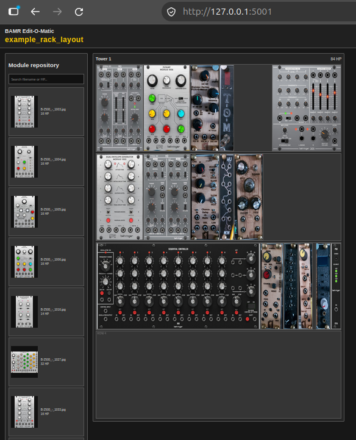

Eurorack-Edit-O-Matic
=====================

This tool shows a grid that can be used to plan 
where to put the modules in your eurorack.
I was inspired to make this stand alone version
when I saw modulargrid. I have not implemented
any of the statistics features as they are of
no importance to me. This tool was made
so that I could more easily plan my 3rd eurorack
tower.

It allows you to drag modules from the repository 
to an 84 HP rack, move them about or delete them from the rack.
You need to adapt the repository.py to contain
all you modules. Install images of your module
front panels in the scaled_600 directory.
You need to scale the height of the images to 600 px.

In rack_data.py you can define an initial layout.
Each time you click the reset button in the browser page
the layout will revert to the one defined in rack_data.py

The layout in rackdata.py will be loaded when there are 
no layouts in the layout directory. If you do not want to use
rack_data.py simply add the following line in this file:

modules = []

The application is based on flask and it can be started using:

python3 ./app.py --port 5000 --nr_towers 1 --nr_rows 4

This will show a rack of 84 HP with 4 rows if you enter http://127.0.0.1:5000 in your browser.

  --port PORT           port for browser contact

  --nr_towers NR_TOWERS
                        Number of towers 

  --nr_rows NR_ROWS     Number of rows in tower

My rack consists of several towsers of multiple 19 inch cases.
In my setup a tower is a rack of 19 inch cases which
measure 84 HP. The width is a fixed value in app.py
The number of rows you set determines the number of
rows of all towers. Mine are all of equal size.
If yours differ I would suggest to run several
instances of app.py giving each a uniq port and
a layout directory to store the layouts you make.
Make sure to use only one repository.py file to prevent
maintenance problems.

Note: I shot all pictures from my DIY modules 
from the hip and included some here.
So some of them may look a bit crooked and include parts of patch cables.
